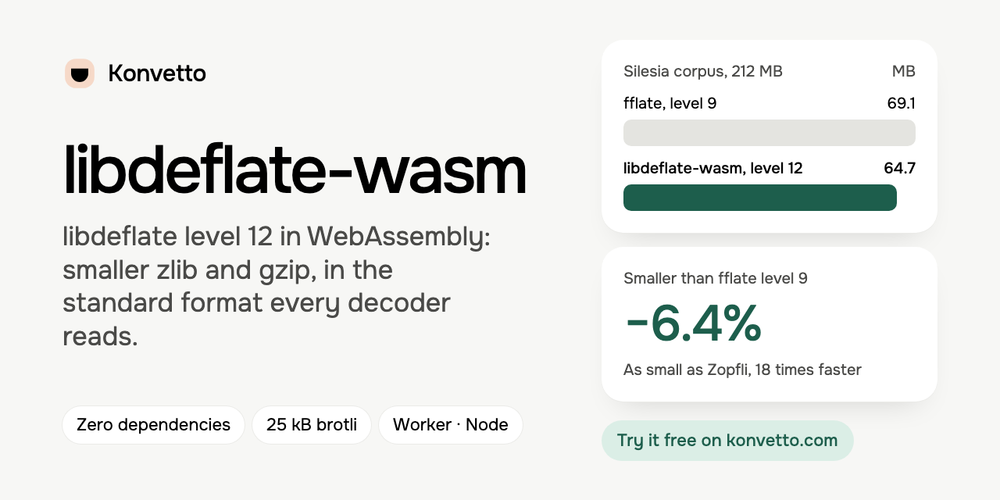
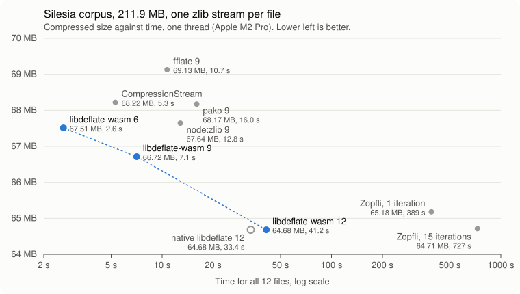

<a href="https://konvetto.com/pdf/compress-pdf"></a>

# libdeflate-wasm

**Smaller zlib, gzip and DEFLATE than fflate, pako and zlib at level 9, in a quarter of the
time.** [libdeflate](https://github.com/ebiggers/libdeflate) 1.26 compiled to WebAssembly, byte
for byte the output of the native library. Level 12 lands within 0.05 percent of Zopfli in an
18th of the time. 25 kB brotli, zero dependencies, synchronous after one `await init()`.

[](https://www.npmjs.com/package/libdeflate-wasm)
[](./package.json)
[](./LICENSE)
[](https://github.com/Konvetto/libdeflate-wasm/actions/workflows/ci.yml)

Measured on the [Silesia corpus](https://sun.aei.polsl.pl/~sdeor/corpus/) (12 files, 211.9 MB),
every file as one zlib stream, one thread, Apple M2 Pro. Full table and method in
[Benchmark](#benchmark); per-file numbers in [bench/results.md](./bench/results.md).

- **Level 6 is the fastest row in the benchmark and already smaller than the others' best**:
  67.51 MB in 2.6 s, against fflate 9 (69.13 MB, 10.7 s), pako 9 (68.17 MB, 16.0 s) and
  node:zlib 9 (67.64 MB, 12.8 s).
- **Level 12 is the smallest output measured**: 64.68 MB, 6.4 percent smaller than fflate 9 and
  4.4 percent smaller than node:zlib 9. Zopfli at 15 iterations reaches 64.71 MB and needs 727 s;
  level 12 needs 41 s.
- **Byte for byte the native output**: level 12 produced the same 64,681,700 bytes as native
  libdeflate 1.26, and the tests pin every level from 1 to 12 against the native build on inputs
  up to 50 MB.
- **Small and self-contained**: 64 kB of wasm (30 kB gzip, 25 kB brotli) plus a 2 kB loader. No
  Emscripten glue, no threads, no `SharedArrayBuffer`, no special headers. Runs in browsers, Web
  Workers, Node, Deno and Bun.

<picture>
  <source media="(prefers-color-scheme: dark)" srcset="https://raw.githubusercontent.com/Konvetto/libdeflate-wasm/main/bench/silesia-dark.svg">
  
</picture>

Where it loses: level 12 is about 4 times slower than fflate at level 9 (41 s against 10.7 s), and
the wasm runs at about 80 percent of the native binary's speed (41.2 s against 33.4 s). libdeflate
works on whole buffers, capped at 1 GiB of input and 2 GiB of output per call; for streaming, use a
streaming compressor.

### Which level

Silesia corpus, 211.9 MB, one thread:

| Level            |     Size |   Time | Use it for                                     |
| ---------------- | -------: | -----: | ---------------------------------------------- |
| **12** (default) | 64.68 MB | 41.2 s | PDF streams, assets built once, archives       |
| **9**            | 66.72 MB |  7.1 s | a middle step: +3.1% size, 5.8x faster than 12 |
| **6**            | 67.51 MB |  2.6 s | on the fly: +4.4% size, 16x faster than 12     |

Even level 6 is smaller than zlib's level 9 (node:zlib 9: 67.64 MB in 12.8 s). Level 0 stores the
data without compression.

Levels 1 to 9 are libdeflate's counterparts of zlib's levels; 10 to 12 use its near-optimal
parser. Decompression has no level; pass the known output `size` when you have it, it is faster.

> **Try it without installing anything:** the [Compress PDF](https://konvetto.com/pdf/compress-pdf)
> tool on Konvetto recompresses every Flate stream of your PDF with libdeflate-wasm, in your
> browser. No upload, no account, your file never leaves the tab.

## Install

```sh
npm install libdeflate-wasm
```

Node 20.16 or newer, any browser with WebAssembly, Deno and Bun. ESM only.

## Usage

```ts
import { init, zlib, deflate, gzip, unzlib } from 'libdeflate-wasm';

await init(); // once, loads libdeflate.wasm next to the module

const flate = zlib(bytes); // zlib stream at level 12, what PDF /FlateDecode wants
const raw = deflate(bytes, 6); // raw DEFLATE, level 0 to 12
const gz = gzip(bytes, 9); // gzip member
const back = unzlib(flate); // and back
```

### In a Web Worker (Vite, webpack 5, Rollup, esbuild)

The module finds its wasm with `new URL('./libdeflate.wasm', import.meta.url)`, which bundlers
turn into an emitted asset:

```ts
// worker.ts
import { init, zlib } from 'libdeflate-wasm';
const ready = init();
self.onmessage = async ({ data }: MessageEvent<Uint8Array>) => {
  await ready;
  const out = zlib(data, 12);
  self.postMessage(out, [out.buffer]);
};
```

Vite 8 handles this in both the dev server and production builds. If your bundler or an older
Vite dev server answers 404 for the wasm, add the package to `optimizeDeps.exclude` or pass the
URL yourself:

```ts
import wasmUrl from 'libdeflate-wasm/libdeflate.wasm?url';
await init(wasmUrl);
```

### Node

```ts
import { init, zlib } from 'libdeflate-wasm';
await init(); // reads the file with node:fs, no fetch
```

### Other ways to load

`init(source)` takes a URL or a string (fetched, or read from disk for `file:`), a `Response`,
the bytes, or a compiled `WebAssembly.Module`. `initSync(bytesOrModule)` does the same
synchronously. Once one of them has loaded the module, every further call is a no-op (a different
`source` is ignored), and `init` and `initSync` racing in the same tick still create one
instance.

`initSync` with raw bytes works in Web Workers, Node, Deno and Bun. On a browser's main thread,
synchronous compilation of large modules may be refused (Chrome long rejected anything over
4 KB), so pass a `WebAssembly.Module` there (for example from `WebAssembly.compileStreaming`) or
use `init`.

**Content Security Policy:** compiling wasm needs `script-src 'wasm-unsafe-eval'` (or
`'unsafe-eval'`) on pages with a CSP. The package uses no `eval` and no `new Function`.

## API

| Function                     | Returns                                                      |
| ---------------------------- | ------------------------------------------------------------ |
| `init(source?)`              | `Promise<void>`. Loads the wasm. Safe to call many times.    |
| `initSync(source)`           | Synchronous `init` from bytes or a `WebAssembly.Module`.     |
| `isReady()`                  | `true` once loaded.                                          |
| `deflate(data, level = 12)`  | Raw DEFLATE (RFC 1951).                                      |
| `zlib(data, level = 12)`     | zlib stream (RFC 1950): 2-byte header, DEFLATE, Adler-32.    |
| `gzip(data, level = 12)`     | gzip member (RFC 1952), no file name, mtime 0.               |
| `inflate(data, size?)`       | Raw DEFLATE back to bytes.                                   |
| `unzlib(data, size?)`        | zlib stream back to bytes.                                   |
| `gunzip(data, size?)`        | The first gzip member back to bytes.                         |
| `release()`                  | Frees the cached compressors and decompressor.               |
| `MAX_LEVEL`, `DEFAULT_LEVEL` | `12`, `12`.                                                  |
| `MAX_INPUT`, `MAX_OUTPUT`    | 1 GiB per input, 2 GiB minus 64 KiB per decompressed output. |

Levels: 0 stores without compression, 1 to 9 are close to zlib's speed steps (and smaller),
10 to 12 use libdeflate's near-optimal parser. All functions take a `Uint8Array` (a subarray is
fine) and return a new `Uint8Array`. They throw `RangeError` for a bad level or when wasm memory
runs out, `RangeError` for an input over `MAX_INPUT`, `TypeError` for a non-`Uint8Array` and
`Error` for corrupt data.

Pass `size` to the decompressors when you know the exact output length: it is faster and the
call fails if the length differs. Without it the output buffer starts at four times the input
(for gzip: the size in the member's trailer) and doubles until the data fits. Size hints are
trusted only up to what the input can decode to (DEFLATE expands at most about 1032 times), so a
small corrupt stream cannot make the module reserve gigabytes.

Like libdeflate, the decompressors stop at the end of the first stream: bytes after a zlib or
DEFLATE stream are ignored (PDF streams often end with a line break), and `gunzip` returns only
the first member of a multi-member file, where `node:zlib` would return all of them.

### Memory

Each call copies the input into wasm memory, compresses into a buffer of
`libdeflate_*_compress_bound` bytes (slightly more than the input), copies the result out and
frees both. Compressors are cached per level until `release()`: 8.6 MB for each of levels 10 to
12, 0.64 MB for levels 2 to 9, 0.19 MB for level 1, about 31 MB if all 13 levels are used. The
decompressor holds 11 KB. Decompression without `size` needs the input plus up to twice the
output while it doubles its buffer. wasm memory grows to the largest call and never shrinks, but
freed space is reused, so a loop of large calls does not leak (tested). Call `release()` between
jobs, or drop the worker to hand memory back to the system.

## Benchmark

The [Silesia corpus](https://sun.aei.polsl.pl/~sdeor/corpus/) (12 files, 211.9 MB: text, XML,
source code, executables, a database, medical and astronomical data), each file compressed as one
zlib stream. Apple M2 Pro, Node 26.13.1, one thread, one run.

| Compressor                        |      Bytes | vs fflate 9 |       Time |
| --------------------------------- | ---------: | ----------: | ---------: |
| fflate 0.8.3, level 9             | 69,125,707 |       0.00% |  10,689 ms |
| pako 3.0.3, level 9               | 68,172,560 |      -1.38% |  15,991 ms |
| node:zlib, level 9                | 67,643,273 |      -2.14% |  12,809 ms |
| CompressionStream deflate (Node)  | 68,220,487 |      -1.31% |   5,293 ms |
| libdeflate-wasm, level 6          | 67,510,056 |      -2.34% |   2,612 ms |
| libdeflate-wasm, level 9          | 66,715,157 |      -3.49% |   7,074 ms |
| libdeflate-wasm, level 12         | 64,681,700 |      -6.43% |  41,195 ms |
| native libdeflate 1.26, level 12  | 64,681,700 |      -6.43% |  33,366 ms |
| @gfx/zopfli 1.0.15, 1 iteration   | 65,181,568 |      -5.71% | 388,923 ms |
| @gfx/zopfli 1.0.15, 15 iterations | 64,713,078 |      -6.38% | 727,214 ms |

Zopfli at its default 15 iterations lands within 0.05 percent of libdeflate level 12 on this
corpus (it is smaller on 10 of 12 files, libdeflate is smaller on `mozilla` and `mr`) and takes about 18 times as long;
with 1 iteration it is larger than level 12 and about 9 times slower. Level 6 is the fast
option: smaller than fflate, pako and zlib at level 9 in a fraction of their time.

`CompressionStream` is the one built into Node; browser output can differ slightly by engine.
The wasm output at level 12 is the native output, byte for byte. Native time is one
`libdeflate-gzip` process per file, including file reads and process start. Per-file numbers are in
[bench/results.md](./bench/results.md). Reproduce with:

```sh
./bench/fetch-silesia.sh   # downloads the corpus into bench/silesia (gitignored), checks SHA-256
ZOPFLI_15=1 pnpm bench     # needs libdeflate-gzip in PATH; without ZOPFLI_15 the 15-iteration row is skipped
pnpm bench:chart           # redraws bench/silesia-light.svg and silesia-dark.svg from bench/results.md
```

### Why no SIMD build

libdeflate's SIMD code is hand-written for x86 and ARM (CRC-32, Adler-32, match finder
initialization) and is not compiled for wasm. Building with `-msimd128` (auto-vectorization only)
gave the same speed within 1 percent and a 25 percent larger file, so one baseline build ships,
and it runs on every engine with WebAssembly bulk memory (Chrome 75, Firefox 79, Safari 15,
Node 12 and later).

## Building the wasm

The compiled `src/libdeflate.wasm` is committed, so `pnpm build` needs no C toolchain. To rebuild
it you need Emscripten (7.0.1 is what CI uses):

```sh
pnpm vendor:verify   # vendor/libdeflate matches the pinned release tarball (SHA-256)
pnpm build:wasm      # emcc -O3 -flto, standalone wasm, emmalloc, no JS glue
```

CI checks `vendor/` against the release tarball and rebuilds the wasm with emsdk 7.0.1. The
committed file comes from Homebrew's Emscripten 7.0.1 on macOS, so a Linux build may differ in
bytes; CI reports that as a warning, not a failure. What must never differ is the compressed
output, which the byte-for-byte tests pin.

## License

MIT for this package. The wasm contains libdeflate (MIT, Eric Biggers and Google LLC) and parts of
the Emscripten system libraries (MIT / NCSA); see
[THIRD_PARTY_NOTICES.md](./THIRD_PARTY_NOTICES.md), which ships in the package.

Made by [Konvetto](https://konvetto.com), free tools that run in your browser.
